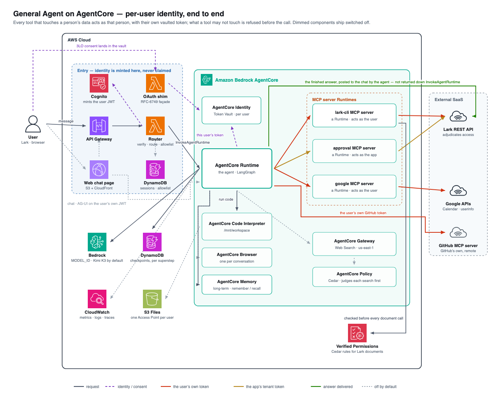

[English](README.md) | [简体中文](README.zh-CN.md)

# General Agent on AgentCore — a full-stack agent sample

<p align="center">
  
  
  
  
  
  
  
  
  
  
</p>

A general-purpose agent on **Amazon Bedrock AgentCore**, reachable from **Lark (Feishu) chat**, a web page with its own sign-in, and peer agents over A2A. Lark is optional: without it the web page is the whole product.

The point of the sample is one property: **every tool acts as the person who asked.** A message resolves to one user — a Lark user, or a web user signed in at the page's hosted login — and any tool touching their data calls the downstream service — Lark, Google, GitHub — with *that user's own OAuth token*, vaulted by AgentCore Identity. The service adjudicates access, so there is no second permission system to keep in sync.

> **Disclaimer.** This is sample code, for non-production usage. You should work with your security and legal teams to meet your organizational security, regulatory and compliance requirements before deployment. See [docs/security.md](docs/security.md) for what it does and does not defend against.



<details>
<summary>Text version — readable in a terminal or by an agent</summary>

```
                                        ┌──────────── AgentCore Identity ────────────┐
                                        │  Token Vault: stores / refreshes / returns │
                                        │  THIS user's Lark token (3LO)              │
                                        └──────────────────┬─────────────────────────┘
  Lark bot chat ──webhook──▶ Router Lambda                 │ the user's own token
  Lark h5 page  ──h5 code──▶ (mints the JWT)               │
  Web page      ──own JWT (Cognito hosted login)──┐        │
  Peer agent    ──bearer───▶ A2A Runtime          │        ▼
                                  └──────▶  Agent (AgentCore Runtime)  ──▶  Lark MCP server
                                            LangGraph + Bedrock             acts AS the user
                                            DynamoDB checkpoints                    │
                                              │          │                          ▼
   the answer, when the turn finishes  ◀──────┘          │                   Lark REST API
   (chat card · SSE · A2A reply)                         │            returns only what THIS
                                                         ▼            user can see
                                          Code Interpreter session
                                          /mnt/workspace ← this user's S3 Files
```

</details>

## What we build

Ten layers, each with a real implementation rather than a stub — that is the "full-stack" in the name. The interesting part is the seams between them.

| Layer | What it decides | How it's built |
|---|---|---|
| **Channel** | how a turn starts, how the answer returns | Lark webhook → router Lambda → answer typed into a streaming CardKit card. Two more surfaces reach the same agent: a web page (AG-UI over SSE; Cognito hosted login, or Lark's h5 sign-in inside the Lark client) that shows a turn the way the card does, and A2A for peers |
| **Model** | which model answers | **Bedrock** over Converse — an open-weight model by default (Kimi K3), any streaming tool-use model via `MODEL_ID`; prompt caching (`cachePoint`) where the model supports it |
| **Agent loop** | the prompt, and how tool calls iterate | LangGraph `create_agent`, plus threshold-triggered summarisation to bound a permanent thread |
| **Identity** | who this turn is, and whose credentials its tools may use | Cognito mints the signed identity; **AgentCore Identity** vaults each person's grant per downstream system; tools act as them |
| **Session state** | what it remembers *within* a conversation | DynamoDB checkpoints, written per superstep, so a turn cut off at the 15-minute cap resumes |
| **Long-term memory** | what it remembers *across* conversations | **AgentCore Memory** via `remember`/`recall` — written only when the model decides a fact should outlast the chat |
| **Persistent storage** | what survives the container, and whose it is | **S3 Files**, one Access Point per user, mounted at `/mnt/workspace`; isolated at the microVM boundary, not by agent code |
| **Tools** | what it can do, and as whom | **MCP servers** on their own Runtimes — `lark-cli` and `google` as the calling user, approvals on the app identity; **Gateway** for web search; **Code Interpreter** for generated code, with `deliver_file` to send a result into the chat and `save_attachment` to open what the user sent |
| **Observability** | what it did, and whether it worked | **AgentCore Observability** for traces and logs; a CloudWatch dashboard over platform metrics plus the agent's own — turn outcomes, tool calls by name, self-repairs |
| **Operations** | how it deploys and tears down | CDK for what CloudFormation covers, control-plane calls for the rest, both ordered by one `./deploy.sh` |

Two AgentCore primitives are deliberately **not** used: Browser (nothing here needs a headless one) and Evaluations — answer quality is a separate concern with its own project, [cs-agent-eval-loop](https://github.com/aleck31/cs-agent-eval-loop), so this repo measures only whether the machinery ran.

Four layers ship switched off, because each adds cost or console work: `WEB_SEARCH`, `WEBUI`, `A2A`, and code execution with its storage (`FILES_STORAGE`). The agent runs without any of them.

Lark is optional too. Leave the `LARK_*` keys empty and set `WEBUI=true`, and the deploy serves the web page alone: users sign in at its hosted login, the admin invites them on its 管理 view, and Lark, Google and GitHub are downstream systems each user authorizes from the chat when a tool first needs one → [docs/deploy.md](docs/deploy.md#without-lark).

## Layout

| Path | What |
|---|---|
| `app.py`, `cdk.json` | CDK app (uv-managed deps). Deployment state goes to `.cdk-state.<DEPLOYMENT_NAME>.json`, not here |
| `.env` | Deployment target (`PROFILE`/`REGION`/`MODEL_ID`) + Lark credentials — gitignored, read by every script |
| `stacks/` | security, agentcore, router, shim, gateway, observability, plus sandbox and webui when their flags are on |
| `agent/` | the agent container, file by file below |
| `webui/` | the web chat page and the admin page (`admin.html`, who may sign in) — static files sharing `login.js`, no build step; deploy-time values arrive as `config.js` |
| `lambda/router/` | Lark webhook: verify/decrypt/tenant-token/send + 3LO consent-wait + the chat commands. Also the only component that mints per-user JWTs (`cognito.py`) |
| `lambda/shim/` | Lark OAuth RFC-6749 façade + 3LO return endpoint (`CompleteResourceTokenAuth`, then DMs the user) |
| `mcp-servers/` | One directory per MCP server, one Runtime each: `lark-cli/` acts as the user against Lark, `google/` does the same against Google (the second system, added to test that the identity chain is not Lark-specific), `approval/` runs approval decisions on the app identity. Each declares its own build/runtime config in `runtime.env`, so adding a server needs no script change |
| `deploy.sh` | the deploy entry point — orders the steps in `scripts/` |
| `scripts/` | step implementations: preflight / provision (base/memory/code/runtime/gateway/a2a/webui) / build-mcp / setup-3lo / setup-lark / subscribe-approvals / manage-allowlist / destroy |
| `tests/` | unit suites per component (`agent/`, `router/`, `shim/`, `mcp/`), run by `run.sh`; `e2e/` needs a deployed stack |
| `mcp-servers/probe/` | a measurement MCP server, not part of the deployed agent — how the findings in `docs/agentcore-behavior.md` were established |

### `agent/`, by role

Start at `core.py`: it is the agent itself. Each directory around it answers one question.

| Path | Role | AgentCore |
|---|---|---|
| `core.py` | **The agent**: system prompt, model and prompt caching, the middleware it runs, `build()` — LangGraph `create_agent` over a session's tools | |
| `middleware.py` | around each model call: steering a mid-turn message in, pictures on the request only, timestamps, summarisation | |
| `server.py` | **the Runtime contract**: `GET /ping`, `POST /invocations` on 8080 — with `Dockerfile` (ARM64) and `entrypoint.sh` (`opentelemetry-instrument`) | Runtime |
| `a2a_server.py` | the Runtime's A2A contract on 9000 (`SERVER_MODE=a2a`), for peer agents | Runtime |
| `tools/` | **what the agent can do**: `assemble()` in `__init__.py` plugs each component in | |
| ├ `memory.py` | `remember` / `recall` | Memory |
| ├ `code_interpreter.py` | generated code in a per-user workspace; `deliver_file`, `save_attachment` | Code Interpreter |
| └ `web_search.py` | web search | Gateway |
| `identity/` | **who is calling, and whose credentials the tools use** | Identity |
| ├ `caller.py` | the verified Cognito token | |
| ├ `grants.py` | per-user grants to downstream systems (`_DOWNSTREAMS`), the consent wall, `/auth`, `whoami` | |
| └ `lark_3lo.py` | vault reads and consent links; the Lark MCP connection | |
| `runtime/` | **one built agent per conversation, one turn at a time** | |
| ├ `sessions.py` | the session cache; DynamoDB checkpoints; history, `/clear`, `/compact` | |
| ├ `turns.py` | claims, the steering queue, the event loop MCP sessions live on | |
| └ `telemetry.py` | agent-level metrics the platform cannot see | Observability |
| `channels/` | **how a turn arrives and the answer leaves** | |
| ├ `lark.py`, `lark_card.py` | Lark: a message answered into a streaming card; the synchronous reply | |
| ├ `agui.py` | the web page, AG-UI over SSE | |
| └ `delivery.py`, `web_files.py`, `images.py` | where a produced file goes per surface; files stored for the web page; pictures and attachments in | |

To change the prompt, set `AGENT_SYSTEM_PROMPT` (default in `core.py`); the model, `MODEL_ID`. A new component goes into `tools/`, wired in `tools.assemble()`; a new downstream system into `identity/grants.py` `_DOWNSTREAMS` → [docs/per-user-oauth.md](docs/per-user-oauth.md).

## Quick start

Needs `uv` ≥ 0.5, Node.js 22 or 24 (for `npx` and the CDK), AWS CLI v2, `python3` ≥ 3.8, `zip`, `openssl`, and AWS credentials; `./deploy.sh preflight` checks them, and its first run downloads Python 3.13+ and the project's packages through uv. Images build natively on ARM64 in CodeBuild; Docker is needed only with `AGENT_BUILD=local`.

```bash
cp .env.example .env    # deployment target, plus a Lark app or the web page (or both)
./deploy.sh             # everything, in dependency order
tests/run.sh            # unit suites, no AWS needed
```

`./deploy.sh` never stops to ask you anything. With a Lark app, it ends by printing two URLs to paste into the Lark console — they don't block the deploy, they gate the bot at runtime (`./deploy.sh urls` reprints them). With the web page, it prints the page's URL and an admin sign-in, `admin@agentcore.local` with its password (`./deploy.sh urls` reprints it).

Three things to know before the first run:

- **The Lark app needs scopes, events and redirect URLs set by hand** → [docs/console-setup.md](docs/console-setup.md). Google and GitHub are optional and on the same page; GitHub needs no admin, so it is the one a workshop can turn on by itself.
- **Individual steps are idempotent** (`./deploy.sh base|mcp|3lo|runtime|lark|…`), and the order matters in one place → [docs/deploy.md](docs/deploy.md).
- **Tear down with `scripts/destroy.sh`.** Deleting the OAuth provider purges every user's vaulted token and mints a new callback URL to register.

Then message the bot, or sign in to the web page. `/help` lists the commands, the same on both:

| Command | What it does |
|---|---|
| `/auth`, `/auth <idp>` | Authorization status per downstream system, with the account each was granted by; authorize one not yet granted |
| `/auth revoke [idp]` | Clear one grant or all, e.g. to grant another account next |
| `/status` | Who you are, both session ids, the microVM serving you, last activity, and which command shows each of the rest |
| `/context` | Turns and tool calls, the context size the last request was billed for, the system prompt, when the thread is summarized, and the prompt cache hit rate |
| `/model` | The model, region and prompt cache mode of the container serving you |
| `/tools` | The tools this conversation really has, grouped by where they came from, with the `/auth` an ungranted system needs |
| `/compact` | Fold the older part of the thread into a summary now, keeping the last few messages |
| `/new`, `/reset`, `/reconnect` | Rotate both ids, the thread only, or the runtime instance only |
| `/clear` | Actually delete this thread's checkpoints |

The runtime session and the checkpoint thread are **independent ids** — one decides which microVM serves you, the other which history the agent reads. Authorization is a third, orthogonal dimension keyed to the user, so `/new` never costs a re-consent.

## Cost

Everything always-on is consumption-priced, so an idle single-user demo runs on the order of a couple USD/month before model usage; Bedrock calls dominate the variable cost. Per-service breakdown and the two charges that accrue while idle: [docs/deploy.md](docs/deploy.md#cost).

## Documentation

| Doc | What's in it |
|---|---|
| [workshop/](workshop/README.md) | Workshop handbook (Chinese): deploy with the web page and GitHub, then verify each capability in 60 minutes |
| [docs/architecture.md](docs/architecture.md) | The full flow, per-hop auth, the consent-wait sequence, the ten layers, repo layout |
| [docs/deploy.md](docs/deploy.md) | Every deploy step, the optional features, teardown, cost, extension points |
| [docs/console-setup.md](docs/console-setup.md) | Lark, Google and GitHub console configuration |
| [docs/security.md](docs/security.md) | Security posture and known limits |
| [docs/agentcore-behavior.md](docs/agentcore-behavior.md) | Measured AgentCore behaviour — **read this before debugging anything platform-level** |
| [docs/per-user-oauth.md](docs/per-user-oauth.md) | How a tool acts as the user in another app, and how to add one |

The identity chain itself is documented in depth by two sibling samples rather than here: [native](https://github.com/aws-samples/sample-lark-identity-on-agentcore-native) (the Token Vault path this repo uses) and [interceptor](https://github.com/aws-samples/sample-lark-identity-on-agentcore-interceptor) (same guarantees, self-managed vaulting).
