# 部署架构

本页说明这次实验会在你的 AWS 账号里部署什么：有哪些组件、请求怎么走、数据存在哪里、哪些资源会持续计费。所有资源名都以 `.env` 里的 `DEPLOYMENT_NAME` 开头，下文写作 `<name>`。

## 架构图

*动画按顺序循环播放一次访问的 7 个步骤：登录、提问、第一次授权 GitHub、以用户身份调用 GitHub、运行代码、搜索与记忆、回答流回浏览器。静态版：[00-architecture.png](images/00-architecture.png)。*

## 三条请求路径

**聊天**：页面从 CloudFront 加载，用户在 Cognito 托管登录页登录（authorization code + PKCE）。之后页面带着**用户自己的** Cognito access token，直接调用 AgentCore Runtime 的 `/invocations`，以 AG-UI 协议通过 SSE 流式接收回答。中间没有自建后端：Runtime 校验这个 JWT，得出用户身份 `web:`，请求里自报的身份一概不信。

**命令**：以 `/` 开头的输入发给 API Gateway 上的 Router Lambda，由 API Gateway 的 JWT authorizer 校验同一个 token。`/help` 由 Router 直接回答；要查询 Agent 状态的命令（如 `/status`、`/auth`、`/tools`），由 Router 带着用户的身份转给 Runtime。

**授权**：工具第一次需要 GitHub 时，Agent 向 AgentCore Identity 申请一个授权链接，页面显示「授权 GitHub」按钮。完整流程：

1. 用户在 GitHub 页面同意授权。
2. GitHub 回调 AgentCore Identity 的回调地址（就是[第 3 步](03-callback-and-login.md)填进 OAuth App 的那个）。
3. AgentCore Identity 跳转到 Shim Lambda 的返回地址，Shim 再把浏览器带回聊天页面。
4. 页面带着用户自己的 token 调用 Router，由 Router 完成授权。token 存进 Token Vault，归属于这个用户。

此后每次调用 GitHub 工具，Agent 都从 Token Vault 取出这个用户的 token，作为 `Authorization: Bearer` 发给 GitHub 官方的 MCP server。

## 部署的资源

### CDK 栈

| 栈 | 主要资源 |
|---|---|
| `<name>-security` | Cognito 用户池（托管登录页、Web 页面用的 app client）；Secrets Manager 里的 Cognito 密码盐，以及一个 Lark 凭证的空位（本实验不用） |
| `<name>-agentcore` | Agent 的执行角色；对话记录表 `<name>-checkpoints`（DynamoDB）；存放大的对话状态和发到页面的文件的桶 `<name>-checkpoints-<账号>-<区域>`；用户文件桶 `<name>-user-files-<账号>-<区域>` |
| `<name>-sandbox` | 代码沙箱的 VPC：一个 NAT gateway、一个 S3 gateway endpoint；S3 Files 文件系统和挂载点；Code Interpreter 的执行角色 |
| `<name>-router` | HTTP API + Router Lambda；身份表 `<name>-identity`（DynamoDB，存会话 id 等） |
| `<name>-shim` | HTTP API + Shim Lambda：OAuth 授权的返回地址 |
| `<name>-webui` | 页面的 S3 桶和 CloudFront 分配 |
| `<name>-gateway` | Web 搜索网关使用的 IAM 角色 |
| `<name>-observability` | CloudWatch dashboard 和告警 |

### 部署脚本用 CLI 创建的资源

这些资源不在 CloudFormation 里，由 `./deploy.sh` 调用 AWS CLI 创建，`scripts/destroy.sh` 会一并删除。

| 资源 | 说明 |
|---|---|
| AgentCore Runtime | 运行 Agent 容器。每个会话分到一个独立的 microVM，空闲一段时间后回收 |
| AgentCore Memory | 长期记忆，每个用户一个独立的命名空间 |
| AgentCore Code Interpreter | 代码沙箱，接入上面的沙箱 VPC；每个用户的会话只挂载自己的工作区 |
| AgentCore Gateway（us-east-1） | 接入内置的 Web 搜索连接器。这个连接器只在 us-east-1 提供，Agent 跨区域调用它 |
| AgentCore Identity | workload identity，以及 GitHub 的 OAuth credential provider `<name>-github` |
| ECR 仓库、CodeBuild 项目 | 在 CodeBuild 里构建 ARM64 的 Agent 镜像，推送到 ECR |
| Cognito 管理员用户、Secrets Manager `<name>/web/admin` | 管理员 `admin@agentcore.local` 和它的密码 |

本实验**不部署** MCP server：GitHub 的工具由 GitHub 官方的远程 MCP server 提供。

### 网络

- Agent Runtime 是公网模式，不在 VPC 里，直接访问 Bedrock、AgentCore 各服务和 GitHub。
- 只有 Code Interpreter 的会话在沙箱 VPC 里。它通过免费的 S3 gateway endpoint 访问工作区，通过 NAT gateway 访问互联网。

## 代码在哪里

Agent 的代码都在 `agent/` 目录，从 `core.py` 看起。

| 想看 | 文件 |
|---|---|
| Agent 本体：system prompt、模型、`create_agent` | `agent/core.py` |
| 各个组件怎么接成工具 | `agent/tools/`：`__init__.py` 里的 `assemble()` 负责接入；Memory 在 `memory.py`，Code Interpreter 在 `code_interpreter.py`，Gateway 在 `web_search.py` |
| 调用者是谁、工具用谁的凭证（Identity） | `agent/identity/` |
| 会话和并发 | `agent/runtime/` |
| 入口：Lark、网页 | `agent/channels/`，网页本身在 `webui/` |
| AgentCore Runtime 的接口规范 | `agent/server.py`：8080 端口的 `/ping` 和 `/invocations` |
| 基础设施和部署 | `stacks/`（CDK）、`scripts/` |

逐个文件的说明见仓库 README 的 [`agent/` 按角色分](https://github.com/aws-samples/sample-general-agent-on-agentcore-fullstack/blob/main/README.zh-CN.md#agent-按角色分)。

## 数据存在哪里

| 数据 | 位置 | 隔离方式 |
|---|---|---|
| 用户账号 | Cognito 用户池 | 关闭自助注册，只有管理员邀请的人能登录 |
| 对话记录 | DynamoDB `<name>-checkpoints`，超过约 350 KB 的状态存在 checkpoint 桶里 | 按用户身份划分线程 |
| 长期记忆 | AgentCore Memory | 每个用户一个命名空间 |
| 代码工作区 | S3 Files，底层是用户文件桶 | 每个用户一个 access point，根目录固定为该用户的目录 |
| 发到页面的文件 | checkpoint 桶的 `deliveries/` 下 | 路径含用户身份的哈希；页面通过最长一小时的预签名链接访问 |
| GitHub token | AgentCore Identity 的 Token Vault | 按用户存放，Agent 只能取当前请求那个用户的 token |

## 费用

主要是按用量计费：Bedrock 按 token，AgentCore Runtime 按 microVM 的 CPU 和内存时长，Memory、Gateway、Code Interpreter 按调用量或会话时长。

闲置时仍在计费的有：

- **NAT gateway**：按小时计费，是闲置时最大的一笔。
- **Secrets Manager**：按 secret 个数，每月计费。
- **还活着的 microVM**：会话空闲后会被回收。回收前，它的内存时长一直在计费。

所以实验结束后请按[第 6 步](06-cleanup.md)清理。各项费用的细节见 [docs/deploy.md](https://github.com/aws-samples/sample-general-agent-on-agentcore-fullstack/blob/main/docs/deploy.md#cost)。

下一步：[1. 准备](01-prepare.md)
