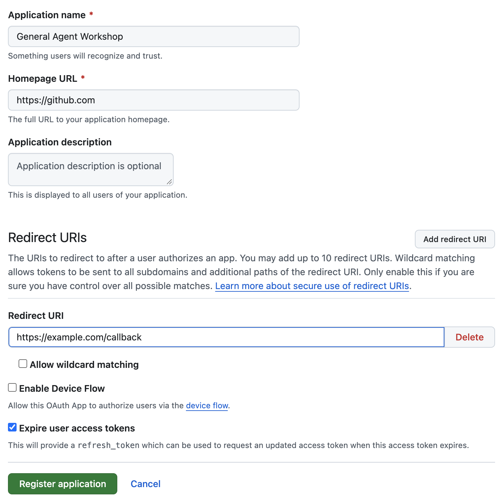
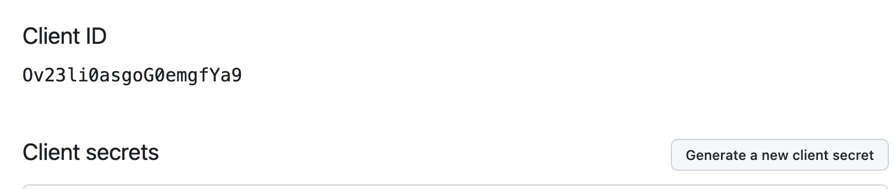

# 1. 准备

约 10 分钟。完成后你会有：装好的本机工具、一个 GitHub OAuth App 的 Client ID 和 Client secret，以及一份填好的 `.env`。

## 1.1 本机工具与 AWS 凭证

### 安装工具

macOS 或 Linux 均可，Windows 用户在 WSL2 里操作。已经装好的可以跳过：

| 工具 | 安装 | 确认 |
|---|---|---|
| `git` | 系统自带，或见 [git-scm.com](https://git-scm.com/downloads) | `git --version` |
| AWS CLI v2 | [AWS CLI 安装指南](https://docs.aws.amazon.com/cli/latest/userguide/getting-started-install.html) | `aws --version` 显示 `aws-cli/2.…` |
| Node.js 22 或 24 LTS | [nodejs.org](https://nodejs.org/) | `node --version` |
| Python 3 | 系统自带，或见 [python.org](https://www.python.org/downloads/) | `python3 --version` |
| uv | [uv 安装指南](https://docs.astral.sh/uv/getting-started/installation/) | `uv --version` |

取得代码：

```bash
git clone https://github.com/aws-samples/sample-general-agent-on-agentcore-fullstack.git
cd sample-general-agent-on-agentcore-fullstack
```

### 配置 AWS 凭证

**Workshop Studio 提供的账号**：在活动页面点击 **Get AWS CLI credentials**，把显示的 `export AWS_ACCESS_KEY_ID=…`、`export AWS_SECRET_ACCESS_KEY=…`、`export AWS_SESSION_TOKEN=…` 几行粘贴进你运行部署的终端。它们只在这个终端窗口里有效，过一段时间会过期：新开终端或者提示凭证过期时，重新复制一次。环境变量里有凭证时，`.env` 里的 `PROFILE` 不起作用。

**你自己的 AWS 账号**：配置一个 profile，用长期密钥用第一条，用 IAM Identity Center（SSO）登录用第二条，然后在 1.3 里把 `.env` 的 `PROFILE` 设成这个名字：

```bash
aws configure --profile workshop        # 按提示填 Access Key ID、Secret Access Key 和默认区域 us-west-2
aws configure sso --profile workshop    # 或者：用 IAM Identity Center 登录
```

两种方式都用下面的命令确认凭证可用（用 profile 时加 `--profile workshop`），能打印出账号 ID 就说明配好了：

```bash
aws sts get-caller-identity
```

其余条件（工具是否齐全、各服务的权限、`.env` 是否填对）由填完 `.env` 后的 [1.4 预检](#14-预检) 一起检查。

## 1.2 创建 GitHub OAuth App

在 GitHub 上打开 **Settings → Developer settings → OAuth Apps → New OAuth App**（或直接访问 <https://github.com/settings/applications/new>），按下表填写：

| 字段 | 填写 |
|---|---|
| Application name | 任意，例如 `General Agent Workshop` |
| Homepage URL | 任意可访问的地址，例如你的 GitHub 主页 |
| Redirect URIs → Redirect URI | 先填占位地址 `https://example.com/callback`，部署后在[第 3 步](03-callback-and-login.md)换成真正的地址 |
| Allow wildcard matching、Enable Device Flow | 不勾选 |
| Expire user access tokens | 保持默认（勾选） |



点击 **Register application**，进入 App 的设置页：

1. 记下 **Client ID**。
2. 点击 **Generate a new client secret**。GitHub 可能要求你重新验证身份，照做即可。
3. 生成的 secret **只显示这一次**，立即复制保存。



> 如果你的 GitHub 账号属于某个限制了 OAuth App 的组织，该组织的仓库在实验中会看不到。这不影响实验，用你的个人仓库即可，详见[常见问题](05-troubleshooting.md#看不到组织的仓库)。

## 1.3 填写 `.env`

```bash
cp .env.example .env
```

用编辑器打开 `.env`，只改下面这些项（每项在文件里的位置不同，逐个找到修改），其余保持默认：

```bash
DEPLOYMENT_NAME=agentcore-fullstack   # 和别人共用一个 AWS 账号时换成自己独有的名字；一个账号默认最多部署 4 套
PROFILE=default                       # 用环境变量里的凭证时不起作用；用自己的账号时填 profile 名
REGION=us-west-2                      # 部署区域：.env.example 里默认是 ap-northeast-1，本实验用 us-west-2

WEB_SEARCH=true                       # Web 搜索：在 us-east-1 建一个 AgentCore Gateway
FILES_STORAGE=true                    # 代码执行 + 每个用户的持久工作区：建一个只给沙箱用的 VPC
NAT_GATEWAY=true                      # 让代码沙箱能联网（pip install、调用外部 API）
WEBUI=true                            # Web 聊天页面：不接 Lark 时这是唯一的入口
A2A=false                             # 本实验不开

LARK_APP_ID=                          # Lark 四项全部清空
LARK_APP_SECRET=
LARK_ENCRYPT_KEY=
LARK_VERIFICATION_TOKEN=

GITHUB_CLIENT_ID=<1.2 记下的 Client ID>
GITHUB_CLIENT_SECRET=<1.2 生成的 secret>
```

**Lark 四项必须清空。** `.env.example` 里它们带着 `cli_xxxxxxxxxxxxxxxx` 这样的示例值，只要 `LARK_APP_ID` 非空，部署就会按 Lark 模式进行。而 `LARK_ADMIN_OPEN_ID` 是空的，预检会因此报错 `Lark is half configured` 并停下。

`DEPLOYMENT_NAME` 是所有资源名的前缀：3–23 个字符，只能用小写字母、数字和连字符，以字母开头。后面查询回调地址、清理资源都会用到它。

`.env` 已被 `.gitignore` 忽略，里面的 secret 不会被提交。

## 1.4 预检

```bash
./deploy.sh preflight
```

预检只读、不部署，它检查四件事：本机工具、AWS 凭证、对各服务的读权限（包括 `us-east-1` 的 AgentCore），以及 `.env` 的配置。通过时会打印部署目标，`lark` 一行应为 `off  (web page only)`。用 profile 时，`region` 一行后面还会显示 `profile: <名字>`：

```text
  deploy  : agentcore-fullstack   (state: .cdk-state.agentcore-fullstack.json)
  account : <你的账号 ID>
  region  : us-west-2
  model   : global.moonshotai.kimi-k3
  lark    : off  (web page only)
  build   : codebuild  (CodeBuild, ARM64 native)
  search  : true  (+ a gateway in us-east-1)
  files   : true  (creates a VPC + S3 Files)
  nat     : true  (code sandbox gets internet; NAT is a fixed hourly cost)
```

报错时，按提示信息到[常见问题](05-troubleshooting.md#预检报错)里查。

下一步：[2. 部署](02-deploy.md)
