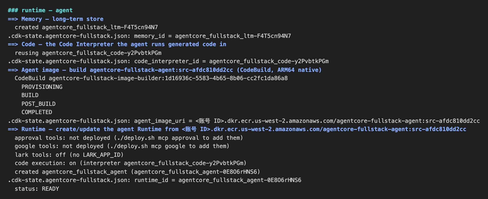
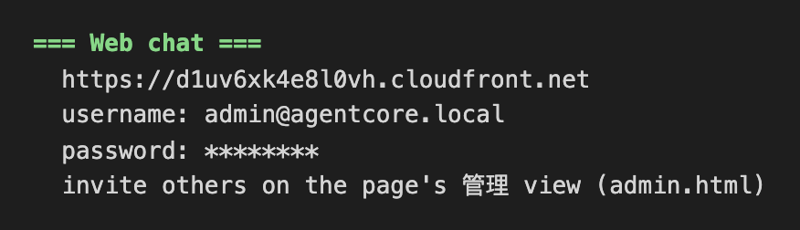

# 2. 部署

约 25–30 分钟，大部分时间在等待。一条命令完成全部部署，中途不需要任何输入。部署期间不要让电脑休眠：休眠时部署会暂停。

## 2.1 运行部署

```bash
./deploy.sh
```

脚本按依赖顺序执行下面这些步骤，每步开始时打印一行 `### <步骤名>`：

| 步骤 | 实际执行的操作 | 本实验中 |
|---|---|---|
| `preflight` | 常规[预检](01-prepare.md#14-预检) | 几秒 |
| `base — CDK stacks` | 部署 7 个 CDK 栈：`security`（Cognito、Secrets Manager）、`agentcore`（执行角色、对话记录表和桶、用户文件桶）、`shim`、`router`、`gateway`、`observability`，以及 `sandbox`（代码沙箱的 VPC、NAT gateway、S3 Files 文件系统和挂载点）。首次部署到一个区域时会先自动执行 `cdk bootstrap` | 约 10 分钟，S3 Files 挂载点最慢（约 5 分钟） |
| `mcp — MCP servers` | 构建并部署 `mcp-servers/` 下的 MCP server | 全部跳过：GitHub 用的是 GitHub 官方的远程 MCP server |
| `3lo — Identity + OAuth provider` | 创建 workload identity `<name>-wl`（返回地址指向 Shim），创建 GitHub 的 OAuth credential provider `<name>-github` 并打印它的回调地址，生成 IdP 注册表供 Router 和 Agent 使用 | 1 分钟内 |
| `gateway — Web Search (optional)` | 在 `us-east-1` 创建 AgentCore Gateway，接入内置的 Web 搜索连接器 | 1 分钟左右 |
| `code — Code Interpreter for generated code` | 创建 Code Interpreter，接入沙箱 VPC，等它变成 READY | 几分钟 |
| `runtime — agent` | 创建 AgentCore Memory；在 CodeBuild 里构建 ARM64 的 Agent 镜像并推送到 ECR；创建 Agent Runtime 并等待 READY；用真实的 Runtime ARN 重新部署 Router；清掉旧的会话 id | 约 5 分钟 |
| `a2a — expose to peer agents` | 供其他 Agent 调用的 A2A Runtime | 跳过（`A2A=false`） |
| `webui — static web chat` | 部署页面的 S3 桶和 CloudFront 分配；把 CloudFront 域名回填，重新部署依赖它的 `security`（登录回调地址）、`router`（CORS）、`shim`（授权完成后跳回的页面）；创建管理员 `admin@agentcore.local`，密码存进 Secrets Manager | 约 6 分钟，CloudFront 最慢 |



## 2.2 部署结束时的输出

部署结束时，最后会打印 Web 聊天页面的地址和管理员账号：

```text
=== Web chat ===
  https://<随机子域名>.cloudfront.net
  username: admin@agentcore.local
  password: <生成的密码>
  invite others on the page's 管理 view (admin.html)
```

记下这三项，[第 3 步](03-callback-and-login.md)要用。密码保存在 Secrets Manager 的 `<DEPLOYMENT_NAME>/web/admin` 里，随时可以重新打印：

```bash
./deploy.sh urls
```



**这份汇总里没有 GitHub 回调地址。** 回调地址只在部署中途的 `3lo` 步骤里打印过一次，夹在大量日志中间，很容易错过。[第 3 步](03-callback-and-login.md#31-查询-github-回调地址)会用命令单独查询它。

## 2.3 等待时可以读的

- 正在部署的每个资源是做什么的：[部署架构](00-architecture.md)
- 页面上的「授权 GitHub」按钮背后发生了什么：[部署架构 → 三条请求路径](00-architecture.md#三条请求路径)
- 每一跳是怎么鉴权的：[docs/architecture.md](https://github.com/aws-samples/sample-general-agent-on-agentcore-fullstack/blob/main/docs/architecture.md)
- 安全边界：[docs/security.md](https://github.com/aws-samples/sample-general-agent-on-agentcore-fullstack/blob/main/docs/security.md)

部署失败时，看[常见问题](05-troubleshooting.md#部署失败)。每个步骤都是幂等的，修复问题后重新运行 `./deploy.sh` 即可。

下一步：[3. 回调地址与登录](03-callback-and-login.md)
