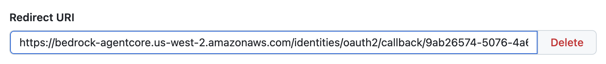
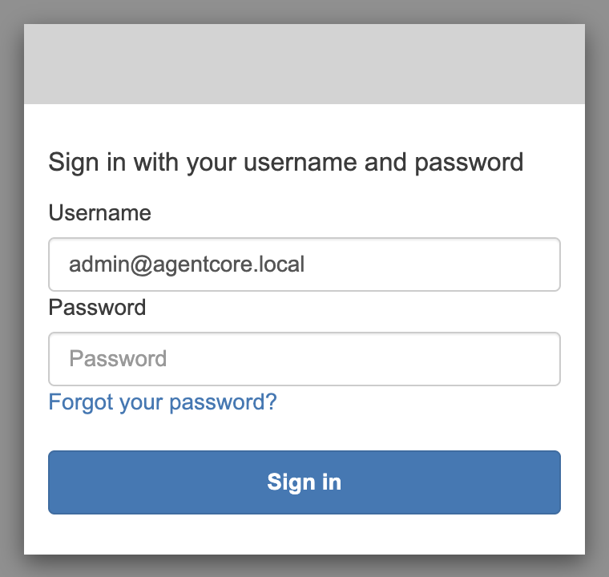
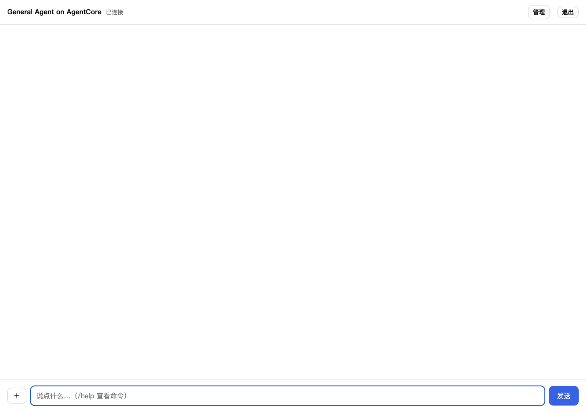

# 3. 回调地址与登录

约 5 分钟。把 AgentCore Identity 为 GitHub 生成的回调地址填回 OAuth App，然后登录 Web 聊天页面。

## 3.1 查询 GitHub 回调地址

部署时创建的 OAuth credential provider 名为 `<DEPLOYMENT_NAME>-github`，它的回调地址由 AgentCore Identity 生成，每次重新创建 provider 都会变。部署结束时的汇总里没有它，用下面的命令查询（`<DEPLOYMENT_NAME>`、`<REGION>` 换成 `.env` 里的值；用 profile 时再加 `--profile <PROFILE>`）：

```bash
aws bedrock-agentcore-control get-oauth2-credential-provider \
  --name <DEPLOYMENT_NAME>-github --query callbackUrl --output text \
  --region <REGION>
```

输出形如：

```text
https://bedrock-agentcore.<REGION>.amazonaws.com/identities/oauth2/callback/<uuid>
```

## 3.2 把回调地址填回 GitHub

回到 GitHub 上你在[第 1 步](01-prepare.md#12-创建-github-oauth-app)创建的 OAuth App 设置页（**Settings → Developer settings → OAuth Apps → 你的 App**），在 **Redirect URIs** 里把 **Redirect URI** 从占位地址换成上一步查到的地址，点击 **Update application**。一个 App 最多可以有 10 个 Redirect URI：同一个 App 给多套部署用时，点 **Add redirect URI** 再加一条即可。



这个地址必须一字不差。填错或者漏填时，授权会在 GitHub 页面上报 `redirect_uri_mismatch`，见[常见问题](05-troubleshooting.md#github-报-redirect_uri_mismatch)。

## 3.3 登录 Web 聊天页面

1. 打开[部署结束时](02-deploy.md#22-部署结束时的输出)打印的 `https://<随机子域名>.cloudfront.net`。
2. 页面跳转到 Cognito 托管登录页，输入用户名 `admin@agentcore.local` 和打印的密码。
3. 登录后回到聊天页面，标题栏显示 **General Agent on AgentCore**，旁边的状态为 **已连接**。





自助注册是关闭的，Cognito 用户池里的用户就是可以登录的全部用户。管理员可以在页面右上角的 **管理** 里邀请或删除用户。

下一步：[4. 验证任务](04-tasks.md)
