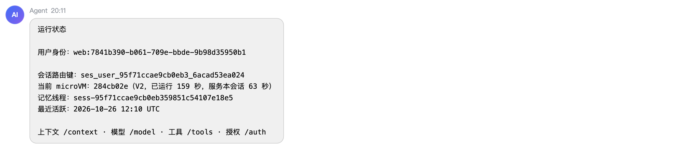
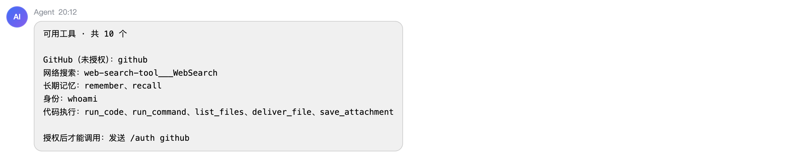
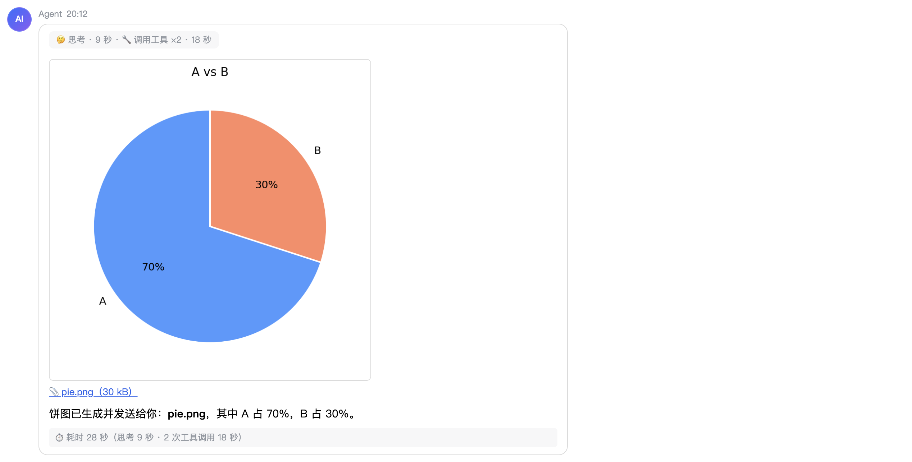
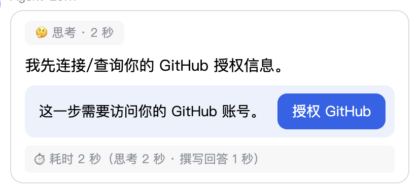
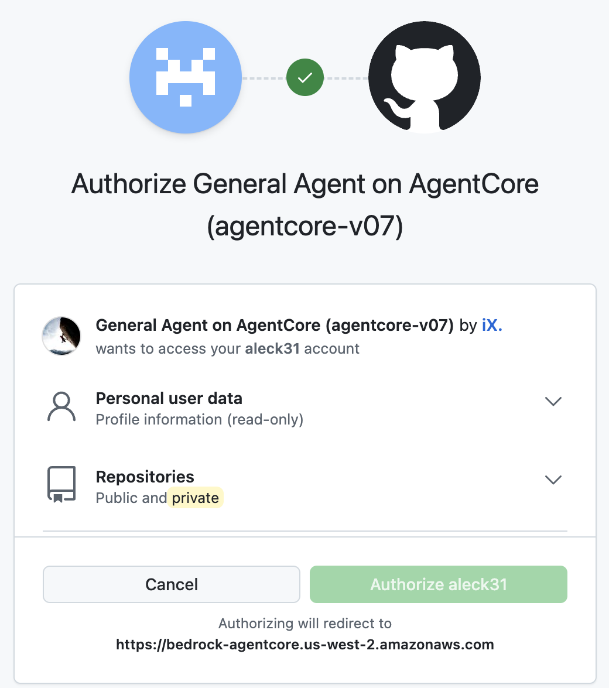
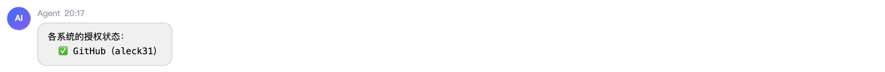

# 4. 验证任务

必做部分约 15 分钟。以下任务都在 Web 聊天页面里完成，按顺序做。标 **（选做）** 的任务可以会后继续：实验环境保留 2 天。

以 `/` 开头的是命令，由 Router 直接回答，不经过模型；其余输入都是发给 Agent 的问题。模型的回答每次措辞不同，下面的预期结果只描述应该出现的内容。

## A. 入口、身份与会话

### A1. 查看当前会话

**操作**：发送 `/status`。

**预期结果**：返回「运行状态」面板，包含以下几行：

- **用户身份**：`web:<一串 id>`。Agent 从你的 Cognito token 里校验出这个身份，不会采信请求里自报的身份。
- **会话路由键**：决定由哪个 microVM 为你服务。
- **当前 microVM**：这个 microVM 的实例信息。
- **记忆线程**：你的对话记录所在的线程。



### A2. 问 Agent 你是谁

**操作**：发送「我是谁？」。

**预期结果**：Agent 调用 `whoami` 工具，回答你是通过 Web 页面登录的 `admin@agentcore.local`，并说明 GitHub 还没有授权。

### A3. 回答过程中继续补充

**操作**：发送「用三段话介绍 Amazon Bedrock AgentCore」，在它回答期间，再发送「再加一段讲 AgentCore Memory」。

**预期结果**：回答过程中，输入框提示「回答中，可以继续补充…」。你的补充出现在对话里，Agent 在同一轮回答里接着处理它，最终的回答包含讲 Memory 的那一段。

### A4. 换运行实例，对话记录保留

**操作**：发送 `/reconnect`，然后发送「我刚才让你介绍的是什么？」。

**预期结果**：

- `/reconnect` 回复「已切换运行实例，对话记录保留（N 轮对话）——对话状态存放在 DynamoDB，不随容器生命周期消失。」
- Agent 能答出你刚才让它介绍 AgentCore。新的 microVM 从 DynamoDB 里读出了对话记录。
- 再发 `/status`，**当前 microVM** 一行和 A1 时不同。

### A5. 查看上下文（选做）

**操作**：发送 `/context`。

**预期结果**：面板显示对话轮数、工具调用次数、上一次请求的上下文大小、系统提示词，以及 prompt cache 命中情况。

## B. 工具

### B1. 查看可用工具

**操作**：发送 `/tools`。

**预期结果**：「可用工具 · 共 N 个」面板，按来源分组：

- **网络搜索**：Web 搜索工具。
- **代码执行**：`run_code`、`run_command`、`list_files`、`deliver_file`、`save_attachment`。
- **长期记忆**：`remember`、`recall`。
- **身份**：`whoami`。
- **GitHub（未授权）**：只有一个名为 `github` 的工具。

面板底部提示「授权后才能调用：发送 /auth github」。GitHub 的 MCP server 在没有用户 token 时不列出任何工具，所以授权前只有这一个占位工具，调用它就会弹出授权提示。



### B2. Web 搜索

**操作**：发送「搜索一下 Amazon Bedrock AgentCore 最近的更新，列出 3 条并给出来源链接」。

**预期结果**：回答卡片顶部显示「调用工具」；回答列出 3 条更新，每条带来源链接。搜索经由 `us-east-1` 的 AgentCore Gateway 完成。

### B3. 运行代码并把文件发到页面

**操作**：发送「用 Python 画一张饼图（A 70%，B 30%），保存为 pie.png 并发给我」。

**预期结果**：卡片里显示这张饼图，下面有 `📎 pie.png` 下载链接。代码运行在 Code Interpreter 沙箱里，原件保存在你自己的 S3 Files 工作区中。发到页面的那一份另存在 checkpoint 桶里，刷新页面时重新生成访问链接，所以图片仍会显示。



### B4. 生成视频（选做）

**操作**：发送「用 opencv 做一个 3 秒的小视频：红色圆从左移到右，保存为 ball.mp4 并发给我」。

**预期结果**：卡片里出现视频播放器，点击可以播放。opencv 默认写出的编码浏览器播放不了，`deliver_file` 发送前会自动转成 H.264。

### B5. 沙箱联网（选做）

**操作**：发送「用 pip 安装 cowsay，然后用它输出 hello」。

**预期结果**：安装成功，回答里是 cowsay 画出的 hello。沙箱经 NAT 访问互联网；没有 NAT 时它只能访问 S3。

### B6. 长期记忆

**操作**：

1. 发送「记住：我希望回答先给结论，再给理由」。
2. 发送 `/new`，开启一个新对话。
3. 发送「你记得我对回答方式有什么偏好吗？」。

**预期结果**：

- 第 1 步，Agent 调用 `remember`，确认已经记下。
- `/new` 回复「已开启新会话：新的对话记录，且由新的运行实例处理。」
- 第 3 步，新对话里没有之前的记录，Agent 调用 `recall`，从 AgentCore Memory 里找到你的偏好并复述出来。

## C. 以你的身份访问 GitHub

### C1. 授权前的状态

**操作**：发送 `/auth`。

**预期结果**：

```text
各系统的授权状态：
  ❌ GitHub — 发送 /auth github 授权
```

### C2. 第一次用到 GitHub 时授权

**操作**：发送「我在 GitHub 上是谁？再列出我最近更新的 3 个仓库」。

**预期结果**：

1. Agent 调用 GitHub 工具时发现你还没授权，回答卡片里出现「这一步需要访问你的 GitHub 账号。」和 **授权 GitHub** 按钮。

   

2. 点击按钮，新标签页打开 GitHub 的授权页面，显示你在[第 1 步](01-prepare.md#12-创建-github-oauth-app)创建的 App 名称，以及它请求的权限（`repo`、`read:user`）。点击 **Authorize**。

   

3. 授权完成后标签页自动关闭，聊天页面显示「✅ 已授权 GitHub」，并自动重新发送你刚才的问题。如果你的 GitHub 账号以前授权过这个 App，GitHub 不再显示授权页面，标签页打开后马上就关闭了。
4. Agent 回答你的 GitHub 用户名，并列出 3 个仓库。

GitHub token 存在 AgentCore Identity 的 Token Vault 里，属于你这个用户。Agent 每次调用 GitHub 时从 vault 取出它，以你的身份调用 GitHub 官方的 MCP server。

### C3. 授权后的状态

**操作**：发送 `/auth`，再发送 `/tools`。

**预期结果**：

- `/auth` 显示 `✅ GitHub（<你的 GitHub 用户名>）`，括号里是用这个 token 向 GitHub 查到的账号。
- `/tools` 里的 GitHub 一组变成二十多个工具，例如 `get_me`、`search_repositories`、`get_file_contents`、`list_issues`。



### C4. 默认只读

**操作**：发送「在我的某个仓库里新建一个 issue，标题是 test」。

**预期结果**：Agent 说明它没有创建 issue 的工具，做不到。GitHub 的工具默认只读：Agent 连接 GitHub 时带着 `X-MCP-Readonly: true`，GitHub 不会给它任何写操作的工具。只读是 MCP server 这一层的限制：授权时申请的是 `repo` 和 `read:user`，token 本身能写你的仓库。`.env` 里设 `GITHUB_MCP_READONLY=false` 就会放开写操作。

### C5. 重复授权

**操作**：发送 `/auth github`。

**预期结果**：回复「已授权 GitHub（<你的 GitHub 用户名>）。要换账号，先发送 /auth revoke github。」，不会再生成授权链接。

### C6. 清除授权（选做）

**操作**：发送 `/auth revoke github`，然后再问一次「我在 GitHub 上是谁？」。

**预期结果**：

- `/auth revoke github` 回复「已清除 GitHub 的授权。下次用到时会重新请你授权，可以换一个账号。」，并提示 GitHub 那边的授权记录仍在，可以到 GitHub 的 Settings → Applications 里删除。
- 再问时，「授权 GitHub」按钮重新出现。点击后 GitHub 不再显示授权页面就直接完成了：你在 GitHub 那边对这个 App 的授权还在。想换一个 GitHub 账号授权，要先在 GitHub 的 **Settings → Applications → Authorized OAuth Apps** 里撤销这个 App。

## D. 更多（选做）

- **图片输入**：点击输入框左边的 **＋**，选一张图片，问「图里有什么？」。Agent 能看到这张图片，并且只在这一轮看到它，后续轮次不会重复计费。
- **刷新页面**：刷新后最近的对话、生成的图片和视频仍在。
- **管理用户**：点击右上角 **管理**，用一个你能收到邮件的地址邀请用户。Cognito 会给他发一封带临时密码的邮件。这封邮件用 Cognito 的默认发信，可能进垃圾箱，每个账号每天最多发 50 封。

下一步：[6. 清理](06-cleanup.md)。遇到问题看 [5. 常见问题](05-troubleshooting.md)。
