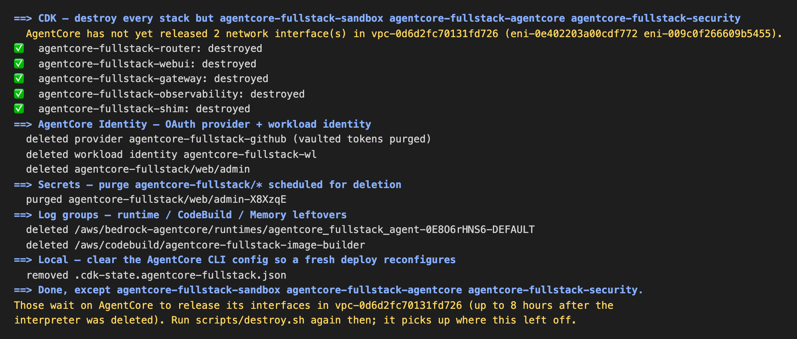
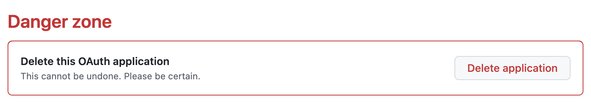

# 6. 清理

约 7 分钟。Workshop Studio 提供的账号在 2 天后连同里面的资源一起回收，可以不清理；做完了想提前释放，也可以照本章清理。用你自己的 AWS 账号时，实验结束后请务必清理：部署的资源会持续计费，NAT gateway 按小时计费。

## 6.1 删除部署的资源

```bash
scripts/destroy.sh
```

脚本先列出要删除的内容，然后要求你输入 AWS 账号 ID 确认。不想确认时用 `scripts/destroy.sh --yes`。

它按依赖顺序删除 `./deploy.sh` 创建的全部资源，包括：Agent Runtime、Code Interpreter、AgentCore Memory（含所有长期记忆）、`us-east-1` 的 Web 搜索网关、所有 CDK 栈、ECR 镜像和 CodeBuild 项目，以及 GitHub 的 OAuth provider 和 vault 里所有用户的 token。脚本可以重复运行，已删除的资源会被跳过。

**可能需要再运行一次。** 代码沙箱运行在 VPC 里，AgentCore 在沙箱子网里创建的网络接口要由 AgentCore 自己释放，最长需要 8 小时。释放之前，`<DEPLOYMENT_NAME>-sandbox`、`<DEPLOYMENT_NAME>-agentcore`、`<DEPLOYMENT_NAME>-security` 三个栈删不掉，脚本会保留它们，并在结尾提示：

```text
Done, except <DEPLOYMENT_NAME>-sandbox <DEPLOYMENT_NAME>-agentcore <DEPLOYMENT_NAME>-security.
```

刚删掉 Code Interpreter 时几乎总会出现这种情况，输出如下：



保留的 sandbox 栈里有 NAT gateway，会继续按小时计费：

- **Workshop Studio 提供的账号**：活动结束后整个账号会被回收，剩下的栈不用处理。
- **你自己的 AWS 账号**：过几个小时再运行一次 `scripts/destroy.sh`，它会从上次停下的地方继续，删掉这三个栈。

## 6.2 删除 GitHub OAuth App

在 GitHub 的 **Settings → Developer settings → OAuth Apps → 你的 App** 里，打开左侧的 **Advanced**，在 **Danger zone** 点击 **Delete application**。再到 **Settings → Applications → Authorized OAuth Apps**，确认这个 App 已经不在列表里。



## 6.3 本地文件

`.env` 里有 GitHub 的 client secret。App 删除后这个 secret 就失效了；不再使用这份代码时，可以把整个目录删掉。
